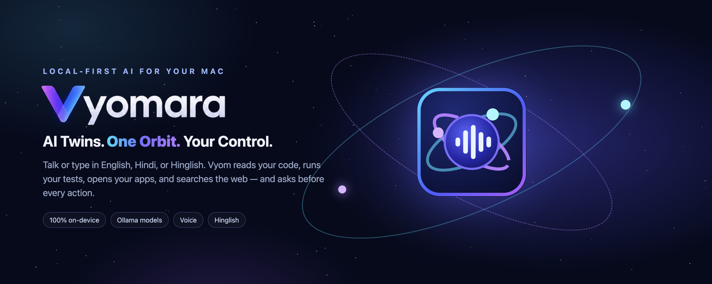
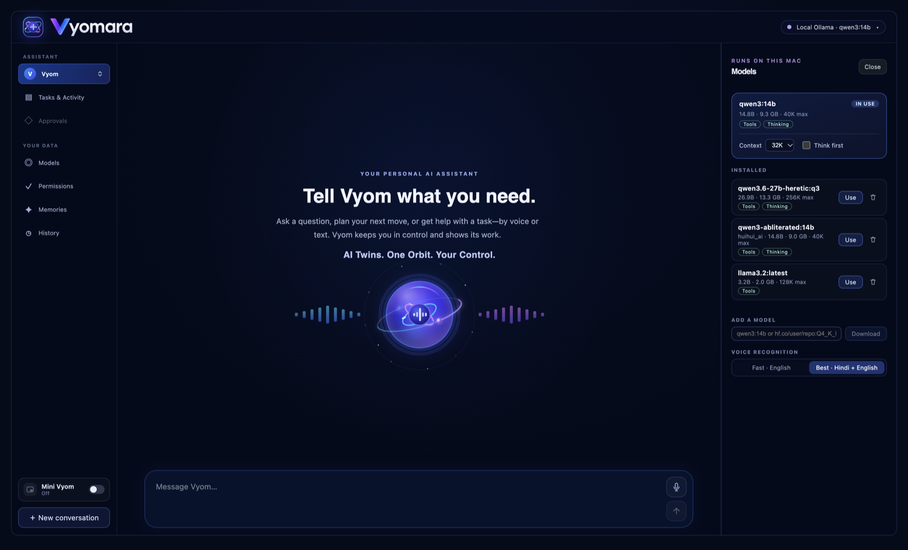
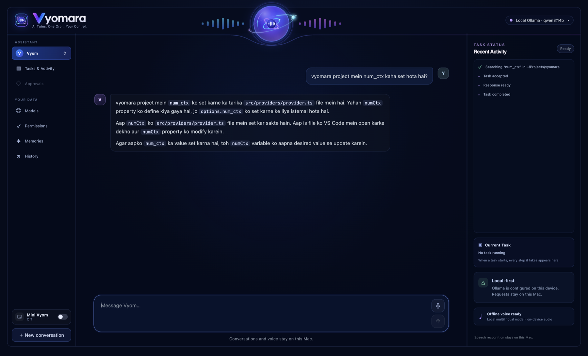
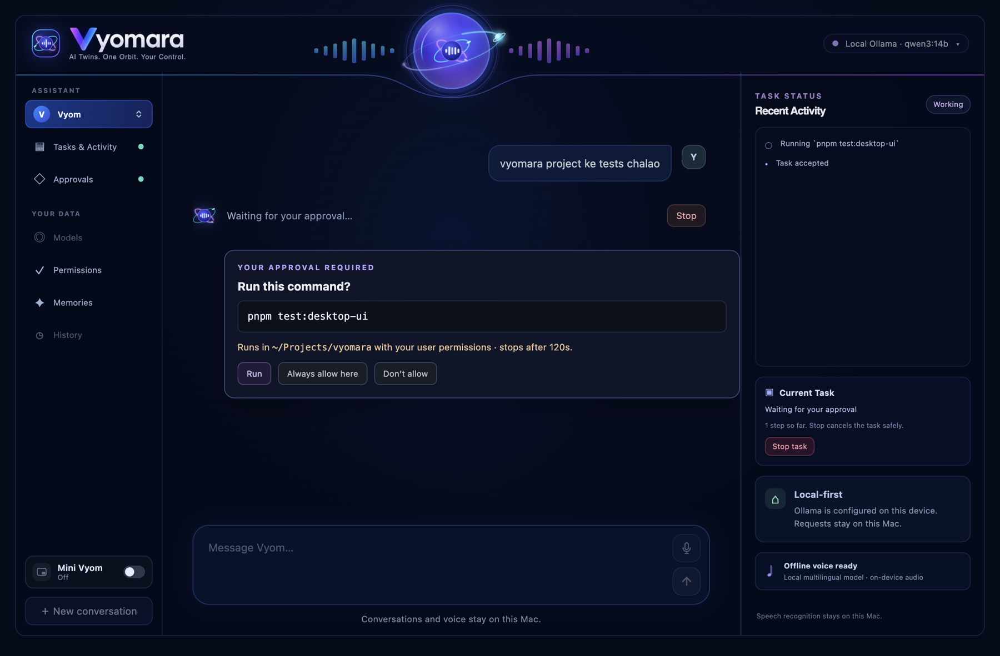
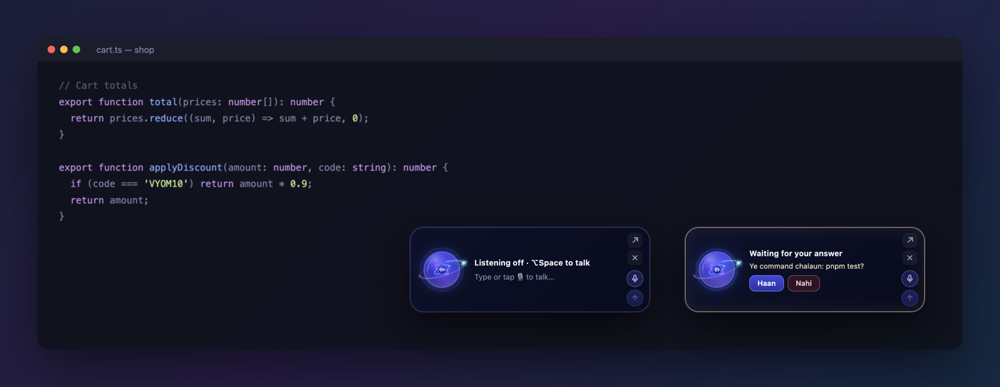
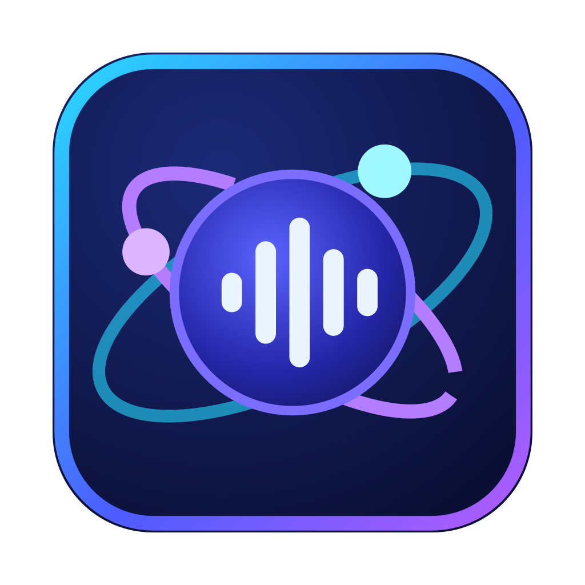

<div align="center">



<br>

**Your own AI assistant for the Mac: it codes, opens apps, browses the web, and talks with you in English, Hindi, or Hinglish.
It runs entirely on your Mac and asks before every action.**

<br>


[Features](#-what-it-can-do) · [Mini Vyom](#-mini-vyom) · [Quick start](#-quick-start) · [Models](#-models) · [Voice](#-voice) · [Safety](#-safety-first) · [Docs](#-documentation)

</div>

---

## ✨ Meet Vyom and Vyomara

Vyomara is a **local-first AI agent for macOS** with two assistants, the *AI Twins*:

| | Assistant | Voice |
|---|---|---|
| 🔵 | **Vyom** | Aman (Indian English), replies aloud in Roman-letter Hinglish |
| 🟣 | **Vyomara** | Lekha (Hindi), who also reads English |

Describe what you want in plain words. The assistant finds the right project
on your Mac, reads and changes code, runs tests, opens apps and websites, and
searches the web. Every model runs on your machine through
[Ollama](https://ollama.com): **no cloud model, no account, no data leaving
your Mac.**

<p align="center">
  
  <br><sub>The home screen, with the <b>Models</b> panel open on the right.</sub>
</p>

## 🚀 What it can do

| You say… | Vyom does… |
|---|---|
| *"vyomara project mein num_ctx kaha set hota hai?"* | Finds the project by name, searches the code, and answers with the file and line. |
| *"shop project ka failing test fix karo"* | Runs the tests, reads the failure, proposes a fix as a diff, and runs the tests again. |
| *"src/agent ka structure samjhao"* | Maps the folder, reads the key files, and explains them. |
| *"keylessrn project VS Code mein kholo"* | Finds even nested projects (`~/Projects/openSpace/KeylessRN`) and opens them. |
| *"cart.js mein applyDiscount VS Code mein kholo"* | Finds the definition and opens VS Code at that line. |
| *"aaj ki top news kya hai?"* | Reads current headlines and answers in the chat, with real links. |
| *"react.dev/blog padh ke batao latest post kya hai"* | Reads the page itself and answers with a link. |
| *"VS Code full screen karo"* | Focuses, hides, minimizes, maximizes, or quits apps. Quitting always asks. |
| *"undo karo"* | Puts back the last request's approved file changes. |
| *"yaad rakhna: mera main project KeylessRN hai"* | Remembers it for future conversations (see **Memories**). |

<p align="center">
  
  
  <br><sub>Left: an answer found by reading the real code. Right: nothing runs until you approve it.</sub>
</p>

**Built for coding work**

- 🧭 **A plan you can watch:** a live checklist for multi-step tasks, plus every step it takes ("Reading …", "Running `pnpm test`").
- 🧾 **Diffs in VS Code:** proposed edits open side by side in VS Code. One click approves all edits in a task.
- ↶ **Undo:** undo any request's approved file changes.
- 📘 **Project rules:** follows your project's `AGENTS.md`, `CLAUDE.md`, `.github/copilot-instructions.md`, or `.cursorrules`.
- ✅ **Verified actions:** every reply ends with a list built only from real tool results, so the assistant never claims work it did not do.
- 🗂️ **History:** search past conversations, resume one, or delete it.

## 🪐 Mini Vyom

<p align="center">
  
</p>

A small, always-on-top assistant for when you are working in VS Code, Chrome,
or any other app. Turn it on with the **Mini Vyom** switch at the bottom of
the sidebar (it is off by default). It shows:

- whether it is listening, and what it heard;
- what it is doing right now;
- approval questions, answered with **Haan / Nahi**.

Press **⌥Space** anywhere to talk, type or dictate in its box, drag it
anywhere, or click **↗** to open the full window. It only animates while it
listens or speaks, so it never takes GPU time from your model.

## ⚡ Quick start

**Requirements**

- A Mac with Apple Silicon (24 GB RAM recommended for 14B models)
- Node.js `>= 22.22.1` and pnpm `12.16.1`
- [Ollama](https://ollama.com), running locally

```sh
# 1. Get a model with tool calling (about 9 GB)
ollama pull qwen3:14b

# 2. Build Vyomara and install it in /Applications
pnpm install
pnpm install:mac
```

After that, open **Vyomara** from Launchpad, Spotlight, or the Dock like any
other app. `pnpm package:mac` builds the app and a `.dmg` in `release/`
without installing them, and `pnpm desktop` runs the app straight from the
source while you develop. See [Building and installing](docs/building.md).

The first reply comes back in about a second. While the model loads, Vyomara
has it read the assistant's instructions in the background.

## 🧠 Models

Choose and manage models from the **Models** panel, with no code or config changes:

- download any model from the Ollama library, or GGUF models from Hugging Face (`hf.co/…`);
- see what each model supports: **Tools**, **Thinking**, **Vision**, or **Chat only**;
- switch models with one click (the previous model is unloaded to free memory);
- set the context window and turn "think first" on or off;
- remove models you no longer need;
- start Ollama if it is not running.

The default model is `qwen3:14b`. Read more in [the Ollama guide](docs/ollama.md).

## 🎙️ Voice

Speak Hindi, English, or a mix of the two. Speech recognition runs **on your Mac**.

1. Install the speech runtime once: `brew install whisper.cpp`.
2. In **Models → Voice recognition**, choose **Best · Hindi + English** (574 MB) or **Fast · English** (148 MB).
3. Press the orb, or **⌥Space**, and talk.

<details>
<summary><b>How a voice conversation works</b></summary>

- **Tap to record:** tap the mic, speak, then tap ■. The words appear in the
  message box so you can edit them before sending.
- **Conversation:** press the orb and just talk. No wake phrase is needed.
  The assistant waits for about 1.5 seconds of quiet, answers on screen and
  aloud, then listens again.
- Press the orb while it is talking to interrupt it.
- While it works, only "ruko / stop" (or a request that starts with "Vyom …")
  is taken, so room noise does not become a request.
- Approvals can be spoken: answer "haan / kar do" or "nahi / rehne do".
  Deleting needs "haan, delete karo".
- Say "bas" or "band karo" to end. A conversation also ends after two quiet
  minutes.
- For more natural speech, install the Enhanced or Premium versions of Aman
  and Lekha: System Settings → Accessibility → Spoken Content → Manage Voices.

See [ADR-0018](docs/adr/0018-voice-wake-phrase-spoken-approvals.md).
</details>

## 🛡️ Safety first

Nothing happens behind your back:

| Action | What you see first |
|---|---|
| File edit | A diff, in Vyomara and in VS Code. **Approve all edits in this task** applies the rest without asking again. |
| Delete | You type `DELETE`, and the item goes to the Trash. |
| Shell command | The exact command and the folder it runs in. |
| App, website, or web read | What opens, and which site receives the request. **Always allow** remembers trusted ones (revoke them in **Permissions**). |
| Chrome | Used only when you ask for the browser. Normal web questions are answered in the chat. |

- **Protected places:** `/System`, `/usr`, `~/.ssh`, keychains, and cloud credentials are blocked. Symlinks are never followed.
- **Safe edits:** edits are atomic, and they fail if the file changed after you reviewed it.
- **No made-up links:** links that did not come from a real source are removed from replies.
- **Untrusted content:** text in files and web pages is treated as data, never as instructions.
- **Your data:** conversations stay in a local database until you delete them. Use FileVault for encryption at rest.

Commands run with your user permissions and are not sandboxed, so read each one before you approve it.

## 💻 Command line

The CLI uses the same agent, tools, and approvals. It shows diffs and asks `y/N`:

```sh
pnpm dev                                    # interactive chat
pnpm dev -- "find where the cart total is computed in my shop project"
pnpm dev -- --model qwen3:14b "explain src/agent/agent.ts"
pnpm dev -- --session <session-id> "continue"
pnpm dev -- --sessions list | show <id> | delete <id> --confirm
```

<details>
<summary><b>Configuration</b></summary>

Settings are read from environment variables at startup; `.env` files are not
loaded. [`.env.example`](.env.example) lists every setting.

| Variable | Default | Purpose |
|---|---|---|
| `VYOM_OLLAMA_MODEL` | `qwen3:14b` | Model (the Models panel overrides it) |
| `VYOM_OLLAMA_NUM_CTX` | `32768` | Context window requested from Ollama |
| `VYOM_OLLAMA_THINK` | `false` | Let thinking models reason first (slower) |
| `VYOM_MAX_AGENT_ITERATIONS` | `40` | Model steps per request |
| `VYOM_MAX_TOOL_CALLS` | `80` | Tool calls per request |
| `VYOM_COMMAND_TIMEOUT_MS` | `120000` | Maximum command run time |
| `VYOM_ALLOWED_ROOTS` | whole Mac | JSON array to restrict file access |
| `VYOM_SEARXNG_URL` | unset | Your SearXNG instance for web search; without it, Wikipedia and Google News are used |
| `VYOM_PROVIDER` | `ollama` | `placeholder` runs without a model |
| `VYOM_DEBUG` | unset | `1` prints diagnostic events |

The Ollama URL must be loopback (`localhost`, `127.0.0.1`, or `::1`).
</details>

## 🧩 How it works

```
┌──────────────── Electron app ────────────────┐
│  React UI · Mini Vyom · voice (whisper.cpp)  │
└──────────────────────┬───────────────────────┘
                       │ secure IPC
┌──────────────────────▼───────────────────────┐
│  Agent loop ── tools: files · code search ·  │
│  commands · apps · web · browser · memory    │
│        │                                     │
│  Permission gateway ── your approval         │
└────────┬─────────────────────────────────────┘
         │ localhost only
   ┌─────▼─────┐        ┌───────────────────┐
   │  Ollama   │        │ SQLite: history,  │
   │ (your GPU)│        │ memories, audit   │
   └───────────┘        └───────────────────┘
```

Read [the architecture](docs/architecture.md), [the agent tools](docs/tools.md),
and [ADR-0015](docs/adr/0015-coding-agent-loop-and-approved-actions.md).

## 🛠️ Development

```sh
pnpm check             # typecheck + all unit tests
pnpm test:desktop-ui   # Electron UI smoke test
pnpm eval              # agent evaluation against a real model (needs Ollama)
pnpm build             # compile main, preload, and renderer into out/
pnpm package:mac       # standalone Vyomara.app + .dmg in release/
pnpm install:mac       # the same, then install in /Applications
```

Read [CONTRIBUTING.md](CONTRIBUTING.md) before opening a pull request. Use
pnpm only, and never commit secrets.

## 📚 Documentation

| | |
|---|---|
| [Product direction](docs/product-direction.md) | Where Vyomara is going: coding agent → apps & web → voice |
| [Architecture](docs/architecture.md) | Modules and how they fit together |
| [Agent tools](docs/tools.md) | Every tool, its limits, and its approvals |
| [Ollama guide](docs/ollama.md) | Models, context, thinking, and running any local model |
| [Building and installing](docs/building.md) | Every command, the app bundle, the .dmg, and releases |
| [Decisions (ADRs)](docs/adr/README.md) | Why things are built the way they are |

<div align="center">
<br>

<br>
<sub><b>Vyomara</b> · AI Twins. One Orbit. Your Control.<br>Made with ❤️ in India, running on your Mac.</sub>
</div>
