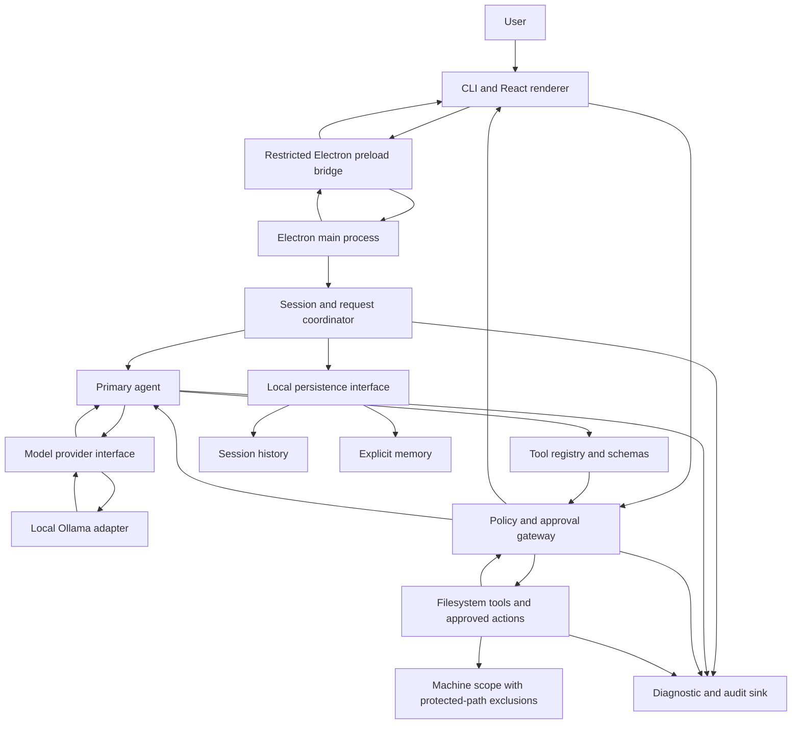

# Vyomara Architecture

## Status

Current as of [ADR-0015](./adr/0015-coding-agent-loop-and-approved-actions.md).
The desktop app and the CLI share one agent that works like a coding agent:

- It loops over model calls and tools until the task is done.
- It discovers projects without manual selection.
- It reads, searches, and edits code through reviewed proposals.
- It runs approved shell commands, and opens apps and web pages after
  approval.

The desktop adds:
- live step activity;
- diff-based review cards;
- History;
- a Models panel for choosing or downloading Ollama models;
- offline voice input.

Later sections still contain some MVP-era phase notes. Where they conflict
with ADR-0015 or [the product direction](./product-direction.md), those
documents win.

## Architecture at a glance

The MVP is a single-process modular monolith with one primary agent. UI,
provider, storage, and tool implementations sit behind narrow interfaces.
There is no worker-agent service, cloud fallback, or direct, unreviewed
filesystem mutation. Shell commands, app launches, and web pages exist only as
approval-gated actions.



Both hosts (Electron main and the CLI) compose the same request service
(`src/app/application.ts`). They differ only in how approvals are shown:

- **Desktop:** cards sent over a typed preload bridge.
- **CLI:** terminal prompts that print a diff.

Each request works like this:
1. It opens or continues a stored session.
2. It builds the tool registry with the host's approval ports.
3. It runs the agent loop (`src/agent/agent.ts`).

The agent's system prompt (`src/agent/system-prompt.ts`) describes:
- the environment: home directory, project folders, and the active project;
- the working rules for the tools that are actually available.

Before each model call, history is fitted to the context budget
(`src/agent/context.ts`). Every reply ends with a verified-actions list built
from tool results.

The Ollama endpoint is loopback-only. The model can be chosen in the desktop
Models panel (stored in local app settings), with `--model` on the CLI, or
with `VYOM_OLLAMA_MODEL`.

## Components and boundaries

| Component | Responsibility | Must not do |
|---|---|---|
| Text interaction adapter | Accept user input; display state, response, errors, and approval requests. | Call a model or tool directly. |
| Electron preload bridge | Expose narrow, typed chat/status/cancel/activity/history/speech IPC methods. | Expose `ipcRenderer`, Node APIs, filesystem, provider, or tool objects. |
| Electron main process | Compose the existing application service and validate renderer IPC. | Bypass the agent, tool executor, policy gateway, or local-provider checks. |
| Session coordinator | Own one session lifecycle, turn ordering, cancellation, and history boundary. | Treat transient context as durable memory. |
| Primary agent | Loop: send history + tools to the model, execute requested tool calls, feed results/errors back, stop on a final answer or a step limit; nudge stalled models; report verified actions. | Grant permissions, bypass approvals, or claim actions no tool result confirms. |
| Provider interface | Define normalized request, response, cancellation, and error contracts. | Expose provider-specific objects to agent or tools. |
| Ollama adapter | Translate the provider contract to the selected local Ollama-compatible API/model. | Silently contact a remote provider or decide policy. |
| Tool registry | Resolve stable tool names, validate input/output schemas, classify effects, and enforce limits. | Allow unknown or model-invented tools to execute. |
| Policy/approval gateway | Check identity, scope, permission, and approval before any side effect; deny by default. | Let model output or a tool self-authorize. |
| Filesystem tools | Name/glob and content search, tree/list, ranged reads; stage edits/creations/deletions for explicit review; enforce protected paths and symlink containment. | Apply an unreviewed change, traverse a symlink, or return unbounded content. |
| Action tools | `run_command`, `open_application`, `open_url`: validate, show the exact action, and run only after per-action approval; bound command output and time. | Run, launch, or open anything without approval, or open non-http(s) URLs. |
| Persistence interface | Separate session history from explicit memory and expose inspect/review/delete operations. | Automatically promote conversation into durable memory. |
| Audit sink | Record bounded, structured operational events with redaction. | Store secrets or full sensitive prompts/file contents by default. |

These are logical boundaries within one process, not separate services.

The desktop renderer runs with context isolation, sandboxing, disabled Node
integration, and web security. It renders assistant Markdown with a small
React renderer (no HTML injection). No remote
font or renderer-side provider request is used.

## Request and tool flows

### User request to response

1. The interaction adapter validates basic input and starts or resumes one
   session.
2. The session coordinator records the turn according to the selected history
   policy and exposes a cancellable request state.
3. The primary agent sends a normalized request through the provider
   interface. The selected local adapter communicates with Ollama.
4. The provider response is parsed and validated as untrusted data. A normal
   answer is returned to the user; a tool proposal proceeds through the
   registry and policy flow below.
5. Session outcome and safe diagnostic metadata are recorded. Provider
   failures, timeouts, invalid output, and cancellation produce explicit
   states, never success-shaped fallbacks.
6. Each request has a task ID and run ID. Structured events distinguish task
   creation/state transitions, model-requested tools, executor invocation,
   execution start after validation and policy authorization, validated
   completion, failure, and bounded correction. Correlation metadata and
   output size are recorded; prompts, argument values, and tool results are
   not included in ordinary activity logs.

### Tool execution

1. The agent proposes a tool name and structured arguments; it cannot invoke a
   function by emitting arbitrary code.
2. The registry rejects unknown names, validates arguments, and applies
   per-tool timeout/output limits and effect classification.
3. Policy checks the effect:
   - `read` and `propose` are always allowed.
   - `shell`, `launch`, and `network` are allowed only when the host supplied
     approval ports.
   - Raw `write`/`delete` effects are always denied.

   Proposal and action tools wait for the user to approve each exact action.
4. The tool executes with least privilege. Filesystem paths are resolved and
   checked against allowed roots, including symlink targets, at the point of
   access.
5. The registry validates and bounds the result before returning it as
   untrusted data to the agent. Policy outcome and tool identity/outcome are
   auditable without logging sensitive content by default.
6. Cancellation, timeout, invalid data, or denial stops the flow; no
   subsequent tool starts after cancellation.

## Provider and Ollama boundary

The agent depends on a provider port, not Ollama SDK/API types. Its contract
must carry normalized messages, model selection/configuration, bounded
responses, cancellation, and typed errors. An adapter owns Ollama transport,
serialization, endpoint/model compatibility, and local availability errors.
No automatic cloud fallback is allowed.

The adapter uses Ollama `/api/chat`:
- It streams in the desktop and makes plain requests in the CLI.
- It always sends `options.num_ctx`.
- It sends `think: false` to thinking-capable models unless
  `VYOM_OLLAMA_THINK=true`.
- It merges tool calls spread across stream chunks.
- It can list and pull models for the Models panel.

The default model is `qwen3:14b`, tested with Ollama 0.40.13 (see
[the Ollama guide](./ollama.md)). Tool definitions come from
registered tools; structured assistant tool-call and tool-result
messages stay in the temporary session. No provider framework or SDK has been
added.

## History and retained local data

Session messages and saved memories are distinct data classes in one local
SQLite database. The CLI creates a new session or resumes one by ID. User
prompts, assistant replies, tool calls, and returned tool data are persisted
after a run, including failed runs where possible. History may contain private
filesystem data and is retained until explicit deletion. Memory is stored
separately and only after explicit confirmation; ordinary conversation is
never converted automatically. Saved memory is currently inspectable and
deletable but is not injected into model context.

The accepted [ADR-0005](./adr/0005-persistence.md) selects the built-in Node
SQLite API, local user-only permissions, retention until explicit deletion,
and explicit-only memory. Memory and older settings/permission data remain
separate in the local store for compatibility, but desktop UI does not expose
them. The database is not application-encrypted. Desktop History supports
individual conversation export and deletion; desktop backup/restore controls
are not available. macOS FileVault is recommended; operating-system backups
may include the database.

## Trust boundaries and failure handling

- **User input, provider output, tool input/output, file content:** untrusted;
  validate structure and size at each boundary.
- **Policy gateway:** sole authorization point for tools and all future
  side effects; fail closed if permissions or approval state cannot be
  established.
- **Filesystem:** desktop-wide access remains under the logged-in user's OS
  permissions and excludes system/credential paths; CLI access remains
  explicitly rooted. Traversal/symlink defenses are mandatory.
- **Network:** local Ollama is the initial provider target. No silent remote
  fallback or undisclosed content transfer.
- **Secrets and diagnostics:** no secrets in source control or ordinary logs;
  avoid prompt/file-content logging by default.
- **Execution:** bound request duration, tool duration/output, agent
  iterations, concurrency, and resource use; cancellation propagates through
  provider and tool boundaries.
- **Failures:** surface typed, actionable errors; preserve completed safe
  work; re-check policy on retry; never turn a failed or cancelled operation
  into a success.

## Source layout

```text
src/
  agent/
    agent.ts            # model/tool loop, nudges, verified actions, activity labels
    system-prompt.ts    # environment discovery (project folders, active project) and rules
    context.ts          # fit history into the model's context budget
  app/application.ts    # request service shared by desktop and CLI; model selection storage
  cli.ts                # terminal chat/REPL with diff and y/N approvals
  config/               # validated environment configuration
  desktop/              # approval managers, macOS launcher, speech, IPC contracts/validation
  main/ preload/        # Electron main process and typed bridge
  providers/provider.ts # provider port, Ollama adapter (chat, list, pull), placeholder
  renderer/             # React UI (chat, approvals with diffs, activity, History, Models)
  session/ tasks/       # in-memory session and task-run lifecycle events
  shared/               # bounded execution, line diff (also used by the renderer)
  storage/              # SQLite sessions, memory, audit events, app settings
  tools/
    contracts.ts executor.ts policy.ts default-tools.ts
    filesystem-tools.ts # discovery, search, ranged reads, reviewed changes
    action-tools.ts     # run_command, open_application, open_url
    command-runner.ts   # zsh runner with bounded output and process-group timeouts
test/                   # node:test suites (agent, tools, approvals, provider, storage, CLI)
```

## MVP implementation sequence

This is the original planning sequence, not a checklist of pending work.
Phases 1–9 implemented the core contracts and validation, policy and executor,
Ollama adapter, bounded agent/task lifecycle, filesystem tools, and local SQLite
history with separately managed explicit memory. Phase 10 starts the desktop
interaction layer. User-facing allowed-root management, memory context
injection, app packaging, project/session browsing, voice, and broader
end-to-end evaluation remain future work.

1. **Resolve Proposed choices** affecting public interfaces: runtime/language,
   text interface, Ollama compatibility target, persistence/privacy policy,
   configuration, diagnostics, test runner, and macOS baseline.
2. **Core contracts and validation:** normalized errors, request cancellation,
   schemas, size/time/iteration limits, and deterministic test fixtures.
3. **Policy and tool boundary:** fail-closed policy, approval state model,
   filesystem scope, and traversal/symlink security tests.
4. **Provider port and local adapter:** fake-provider contract tests first,
   then Ollama compatibility tests with no remote fallback.
5. **Session coordinator and primary agent:** one turn at a time, bounded
   orchestration, typed tool proposals, cancellation, and visible failures.
6. **Persistence only after decision:** implement separate history and
   explicit-memory interfaces plus retention/deletion tests using the
   selected storage design.
7. **Text interaction adapter and composition root:** connect modules, present
   status/errors, and permit explicit root configuration/revocation.
8. **End-to-end safety/evaluation:** adversarial tool-content fixtures,
   path-boundary tests, provider failure tests, repeatable agent evaluations,
   and documented manual checks on the supported Mac baseline.

Dependencies between modules: core contracts precede adapters; policy and
tool validation precede agent tool use; provider and session contracts precede
agent integration; persistence policy precedes durable writes; end-to-end
evaluation follows composition.

## Open decisions requiring user input

The following remain unresolved and are not silently treated as approved:

- Define approval presentation and action scoping before any side-effect
  capability exists (Accepted ADR-0007 records the boundary, not the UX).
- Decide secret injection if a credential-bearing provider is proposed
  (Accepted ADR-0008 defers that future choice).
- Select diagnostic retention/rotation and any opt-in content logging
  (Accepted ADR-0009).
- Define model-evaluation corpus/criteria and benchmark environment
  (Accepted ADR-0010).
- Set minimum macOS version, packaging/distribution, and confirm whether
  Node.js `>=22.22.1` is the production runtime baseline (Accepted ADR-0011).
- Define user-facing allowed-root selection, display, and revocation. Current
  roots are explicitly supplied through `VYOM_ALLOWED_ROOTS`; the default is
  empty and no durable root configuration exists.

See the [ADR index](./adr/README.md) for all recorded decision statuses.
Phase 2 requirements retain their original pre-implementation questions as
historical requirements context; this list reflects the current status.
