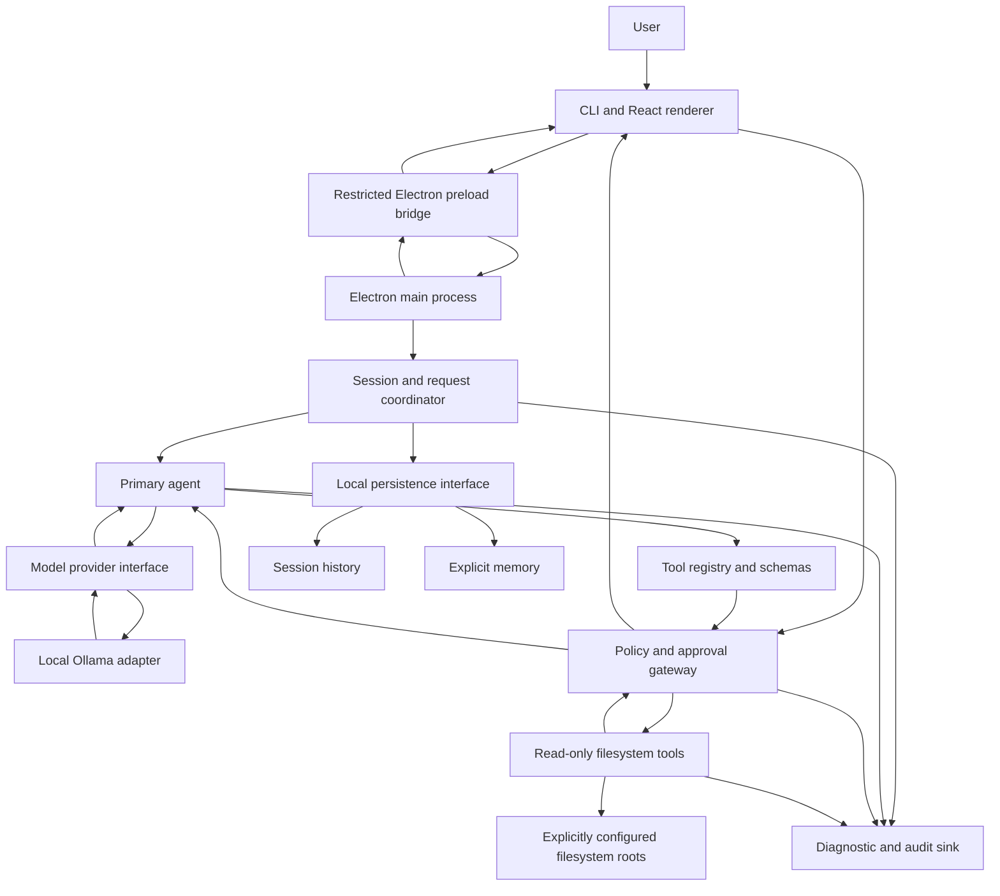

# Vyomara Architecture

## Status

This architecture blueprint was created in Phase 3 and is updated selectively
to reflect implementation status. Phases 1–7.1 implemented the CLI, Ollama
adapter, tool registry/executor/policy gateway, and read-only filesystem
tools. Phase 8 added request-scoped task/run lifecycle events. Phase 9 added
local session history and separately managed explicit memory through SQLite.
Phase 10 added the first Electron/React desktop chat shell. Phase 11 added a
local session-history browser and continuation from the desktop UI. Phase 12
added a local Ollama reachability check and persistent, revocable desktop
filesystem roots. Phase 13 adds explicit desktop memory management. The diagram and component
boundaries also describe proposed or future components; their implementation
status is called out below. Decisions labeled **Accepted** in the
[ADR index](./adr/README.md) are supported by current project requirements or
explicit project direction. Decisions labeled **Proposed** still need user
confirmation.

## Architecture at a glance

The MVP is a single-process modular monolith with one primary agent. UI,
provider, storage, and tool implementations sit behind narrow interfaces.
There is no worker-agent service, cloud fallback, shell tool, or unrestricted
side-effect capability in the MVP.



The CLI stores local session history, supports review, continuation, and
deletion, and offers separate explicitly confirmed memory operations. The
desktop shell uses the same application service and exposes chat, cancellation,
provider configuration status, request-scoped activity, and filtered session
history through a restricted preload bridge. Provider configuration status is
separate from reachability. Memory is not currently injected into model
context. The desktop can make an explicit, loopback-only Ollama reachability
check; it does not verify model installation. Allowed filesystem roots are
selected and revoked through the native folder picker, then persisted in the
owner-only SQLite database. Memory content can be saved only after exact
content review and typed confirmation, inspected, and deleted after review
and typed confirmation; it is not automatically injected into requests. CLI
roots are configured through environment
variables. There is no interactive approval UI. The current Ollama
adapter advertises explicitly registered read-only tools and accepts
structured tool calls. Every requested call still passes through executor
validation and the policy gateway. Invalid arguments receive at most one
structured correction opportunity through the same executor and policy path.
Unsupported shell, web, and filesystem mutation requests are refused without
calling the provider; assistant claims about unsupported execution are not
accepted as evidence. In MVP, policy denies side effects; the
approval gateway is a fail-closed boundary for future approved capabilities,
not permission to add them now.

## Components and boundaries

| Component | Responsibility | Must not do |
|---|---|---|
| Text interaction adapter | Accept user input; display state, response, errors, and approval requests. | Call a model or tool directly. |
| Electron preload bridge | Expose narrow, typed chat/status/cancel/activity/history/filesystem-permission IPC methods. | Expose `ipcRenderer`, Node APIs, filesystem, provider, or tool objects. |
| Electron main process | Compose the existing application service and validate renderer IPC. | Bypass the agent, tool executor, policy gateway, or local-provider checks. |
| Session coordinator | Own one session lifecycle, turn ordering, cancellation, and history boundary. | Treat transient context as durable memory. |
| Primary agent | Interpret a request, request a provider response, and propose typed tool calls within bounded iterations. | Grant permissions, perform filesystem operations, or execute model-generated shell. |
| Provider interface | Define normalized request, response, cancellation, and error contracts. | Expose provider-specific objects to agent or tools. |
| Ollama adapter | Translate the provider contract to the selected local Ollama-compatible API/model. | Silently contact a remote provider or decide policy. |
| Tool registry | Resolve stable tool names, validate input/output schemas, classify effects, and enforce limits. | Allow unknown or model-invented tools to execute. |
| Policy/approval gateway | Check identity, scope, permission, and approval before any side effect; deny by default. | Let model output or a tool self-authorize. |
| Filesystem tools | List/read only within explicit roots and enforce traversal/symlink containment at access time. | Write/delete or return unbounded file content. |
| Persistence interface | Separate session history from explicit memory and expose inspect/review/delete operations. | Automatically promote conversation into durable memory. |
| Audit sink | Record bounded, structured operational events with redaction. | Store secrets or full sensitive prompts/file contents by default. |

These are logical boundaries within one process, not separate services.

The desktop renderer runs with context isolation, sandboxing, disabled Node
integration, and web security. It renders assistant output as text. No remote
font or renderer-side provider request is used.

## Request and tool flows

### User request to response

1. The interaction adapter validates basic input and starts or resumes one
   session.
2. The session coordinator records the turn according to the selected history
   policy and exposes a cancellable request state.
3. The primary agent sends a normalized request through the provider
   interface. The selected local adapter communicates with Ollama.
4. The provider response is parsed and validated as untrusted data. A normal
   answer is returned to the user; a tool proposal proceeds through the
   registry and policy flow below.
5. Session outcome and safe diagnostic metadata are recorded. Provider
   failures, timeouts, invalid output, and cancellation produce explicit
   states, never success-shaped fallbacks.
6. Each request has a task ID and run ID. Structured events distinguish task
   creation/state transitions, model-requested tools, executor invocation,
   execution start after validation and policy authorization, validated
   completion, failure, and bounded correction. Correlation metadata and
   output size are recorded; prompts, argument values, and tool results are
   not included in ordinary activity logs.

### Tool execution

1. The agent proposes a tool name and structured arguments; it cannot invoke a
   function by emitting arbitrary code.
2. The registry rejects unknown names, validates arguments, and applies
   per-tool timeout/output limits and effect classification.
3. Policy checks the request, configured roots, and current permission. MVP
   filesystem tools are read-only. Any future side effect is denied unless a
   separately approved capability and action-specific user approval exist.
4. The tool executes with least privilege. Filesystem paths are resolved and
   checked against allowed roots, including symlink targets, at the point of
   access.
5. The registry validates and bounds the result before returning it as
   untrusted data to the agent. Policy outcome and tool identity/outcome are
   auditable without logging sensitive content by default.
6. Cancellation, timeout, invalid data, or denial stops the flow; no
   subsequent tool starts after cancellation.

## Provider and Ollama boundary

The agent depends on a provider port, not Ollama SDK/API types. Its contract
must carry normalized messages, model selection/configuration, bounded
responses, cancellation, and typed errors. An adapter owns Ollama transport,
serialization, endpoint/model compatibility, and local availability errors.
No automatic cloud fallback is allowed.

The adapter currently uses the non-streaming Ollama `/api/chat` endpoint,
default model `llama3.2`, and loopback endpoint documented in
[ADR-0003](./adr/0003-model-provider.md). A local request has been tested, but
the installed Ollama version was not recorded. Tool definitions come from
registered read-only tools; structured assistant tool-call and tool-result
messages stay in the temporary session. No provider framework or SDK has been
added.

## History and explicit memory data flow

Session messages and saved memories are distinct data classes in one local
SQLite database. The CLI creates a new session or resumes one by ID. User
prompts, assistant replies, tool calls, and returned tool data are persisted
after a run, including failed runs where possible. History may contain private
filesystem data and is retained until explicit deletion. Memory is stored
separately and only after explicit confirmation; ordinary conversation is
never converted automatically. Saved memory is currently inspectable and
deletable but is not injected into model context.

The accepted [ADR-0005](./adr/0005-persistence.md) selects the built-in Node
SQLite API, local user-only permissions, retention until explicit deletion,
and explicit-only memory. The database is not application-encrypted, and
automatic backup/export is not provided. macOS FileVault is recommended;
operating-system backups may include the database.

## Trust boundaries and failure handling

- **User input, provider output, tool input/output, file content:** untrusted;
  validate structure and size at each boundary.
- **Policy gateway:** sole authorization point for tools and all future
  side effects; fail closed if permissions or approval state cannot be
  established.
- **Filesystem:** least-privilege reads only in MVP; explicit roots and
  traversal/symlink defenses are mandatory.
- **Network:** local Ollama is the initial provider target. No silent remote
  fallback or undisclosed content transfer.
- **Secrets and diagnostics:** no secrets in source control or ordinary logs;
  avoid prompt/file-content logging by default.
- **Execution:** bound request duration, tool duration/output, agent
  iterations, concurrency, and resource use; cancellation propagates through
  provider and tool boundaries.
- **Failures:** surface typed, actionable errors; preserve completed safe
  work; re-check policy on retry; never turn a failed or cancelled operation
  into a success.

## Proposed Phase 4 source layout

This is a proposal, not a commitment to a specific CLI framework or storage
package. Module interfaces should remain testable without Ollama or real user
files.

```text
src/
  app/                 # composition root and lifecycle
  interaction/         # proposed text adapter
  sessions/            # session state, turns, cancellation
  agent/               # one primary agent and bounded loop
  providers/
    contracts/         # provider port and normalized types
    ollama/            # isolated local adapter
  tools/
    contracts/         # schemas, registry, result limits
    filesystem/        # read-only tools and allowed-root checks
  policy/              # authorization and approval gateway
  persistence/
    contracts/         # history and explicit-memory ports
  diagnostics/         # redaction, audit event contract
  config/              # validated non-secret configuration
test/
  unit/
  contracts/
  security/
  evaluations/
```

Implementation may adjust names after the language, interaction, and
persistence decisions are confirmed. Keep platform-specific code and
provider-specific behavior inside adapters.

## MVP implementation sequence

This is the original planning sequence, not a checklist of pending work.
Phases 1–9 implemented the core contracts and validation, policy and executor,
Ollama adapter, bounded agent/task lifecycle, read-only tools, and local SQLite
history with separately managed explicit memory. Phase 10 starts the desktop
interaction layer. User-facing allowed-root management, memory context
injection, app packaging, project/session browsing, voice, and broader
end-to-end evaluation remain future work.

1. **Resolve Proposed choices** affecting public interfaces: runtime/language,
   text interface, Ollama compatibility target, persistence/privacy policy,
   configuration, diagnostics, test runner, and macOS baseline.
2. **Core contracts and validation:** normalized errors, request cancellation,
   schemas, size/time/iteration limits, and deterministic test fixtures.
3. **Policy and tool boundary:** fail-closed policy, approval state model,
   allowed-root representation, and traversal/symlink security tests. Expose
   only read-only filesystem tools.
4. **Provider port and local adapter:** fake-provider contract tests first,
   then Ollama compatibility tests with no remote fallback.
5. **Session coordinator and primary agent:** one turn at a time, bounded
   orchestration, typed tool proposals, cancellation, and visible failures.
6. **Persistence only after decision:** implement separate history and
   explicit-memory interfaces plus retention/deletion tests using the
   selected storage design.
7. **Text interaction adapter and composition root:** connect modules, present
   status/errors, and permit explicit root configuration/revocation.
8. **End-to-end safety/evaluation:** adversarial tool-content fixtures,
   path-boundary tests, provider failure tests, repeatable agent evaluations,
   and documented manual checks on the supported Mac baseline.

Dependencies between modules: core contracts precede adapters; policy and
tool validation precede agent tool use; provider and session contracts precede
agent integration; persistence policy precedes durable writes; end-to-end
evaluation follows composition.

## Open decisions requiring user input

The following remain unresolved and are not silently treated as approved:

- Define approval presentation and action scoping before any side-effect
  capability exists (Accepted ADR-0007 records the boundary, not the UX).
- Decide secret injection if a credential-bearing provider is proposed
  (Accepted ADR-0008 defers that future choice).
- Select diagnostic retention/rotation and any opt-in content logging
  (Accepted ADR-0009).
- Define model-evaluation corpus/criteria and benchmark environment
  (Accepted ADR-0010).
- Set minimum macOS version, packaging/distribution, and confirm whether
  Node.js `>=22.22.1` is the production runtime baseline (Accepted ADR-0011).
- Define user-facing allowed-root selection, display, and revocation. Current
  roots are explicitly supplied through `VYOM_ALLOWED_ROOTS`; the default is
  empty and no durable root configuration exists.

See the [ADR index](./adr/README.md) for all recorded decision statuses.
Phase 2 requirements retain their original pre-implementation questions as
historical requirements context; this list reflects the current status.
