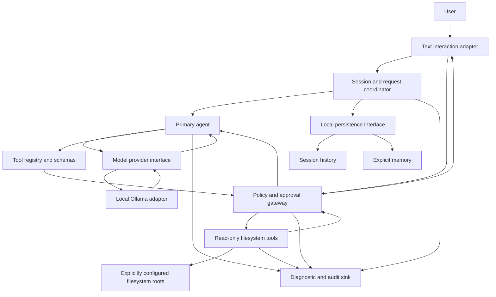

# Vyomara Architecture

## Status

This architecture blueprint was created in Phase 3 and is updated selectively
to reflect implementation status. As of Phases 1–6, the CLI, Ollama adapter,
request-scoped in-memory session, tool registry/executor/policy gateway, and
read-only filesystem tools are implemented. The diagram and component
boundaries also describe proposed or future components; their implementation
status is called out below. Decisions labeled **Accepted** in the
[ADR index](./adr/README.md) are supported by current project requirements or
explicit project direction. Decisions labeled **Proposed** still need user
confirmation.

## Architecture at a glance

The MVP is a single-process modular monolith with one primary agent. UI,
provider, storage, and tool implementations sit behind narrow interfaces.
There is no worker-agent service, cloud fallback, shell tool, or unrestricted
side-effect capability in the MVP.



The persistence interface, durable history/memory, and approval interaction
shown in the diagram are not implemented. Filesystem roots are configured
through environment variables, not through an approval UI. The current Ollama
adapter does not advertise or accept model tool calls; filesystem tools are
registered for the executor but are not callable by the model. In MVP, policy
denies side effects; the approval gateway is a fail-closed boundary for future
approved capabilities, not permission to add them now.

## Components and boundaries

| Component | Responsibility | Must not do |
|---|---|---|
| Text interaction adapter | Accept user input; display state, response, errors, and approval requests. | Call a model or tool directly. |
| Session coordinator | Own one session lifecycle, turn ordering, cancellation, and history boundary. | Treat transient context as durable memory. |
| Primary agent | Interpret a request, request a provider response, and propose typed tool calls within bounded iterations. | Grant permissions, perform filesystem operations, or execute model-generated shell. |
| Provider interface | Define normalized request, response, cancellation, and error contracts. | Expose provider-specific objects to agent or tools. |
| Ollama adapter | Translate the provider contract to the selected local Ollama-compatible API/model. | Silently contact a remote provider or decide policy. |
| Tool registry | Resolve stable tool names, validate input/output schemas, classify effects, and enforce limits. | Allow unknown or model-invented tools to execute. |
| Policy/approval gateway | Check identity, scope, permission, and approval before any side effect; deny by default. | Let model output or a tool self-authorize. |
| Filesystem tools | List/read only within explicit roots and enforce traversal/symlink containment at access time. | Write/delete or return unbounded file content. |
| Persistence interface | Separate session history from explicit memory and expose inspect/review/delete operations. | Automatically promote conversation into durable memory. |
| Audit sink | Record bounded, structured operational events with redaction. | Store secrets or full sensitive prompts/file contents by default. |

These are logical boundaries within one process, not separate services.

## Request and tool flows

### User request to response

1. The interaction adapter validates basic input and starts or resumes one
   session.
2. The session coordinator records the turn according to the selected history
   policy and exposes a cancellable request state.
3. The primary agent sends a normalized request through the provider
   interface. The selected local adapter communicates with Ollama.
4. The provider response is parsed and validated as untrusted data. A normal
   answer is returned to the user; a tool proposal proceeds through the
   registry and policy flow below.
5. Session outcome and safe diagnostic metadata are recorded. Provider
   failures, timeouts, invalid output, and cancellation produce explicit
   states, never success-shaped fallbacks.

### Tool execution

1. The agent proposes a tool name and structured arguments; it cannot invoke a
   function by emitting arbitrary code.
2. The registry rejects unknown names, validates arguments, and applies
   per-tool timeout/output limits and effect classification.
3. Policy checks the request, configured roots, and current permission. MVP
   filesystem tools are read-only. Any future side effect is denied unless a
   separately approved capability and action-specific user approval exist.
4. The tool executes with least privilege. Filesystem paths are resolved and
   checked against allowed roots, including symlink targets, at the point of
   access.
5. The registry validates and bounds the result before returning it as
   untrusted data to the agent. Policy outcome and tool identity/outcome are
   auditable without logging sensitive content by default.
6. Cancellation, timeout, invalid data, or denial stops the flow; no
   subsequent tool starts after cancellation.

## Provider and Ollama boundary

The agent depends on a provider port, not Ollama SDK/API types. Its contract
must carry normalized messages, model selection/configuration, bounded
responses, cancellation, and typed errors. An adapter owns Ollama transport,
serialization, endpoint/model compatibility, and local availability errors.
No automatic cloud fallback is allowed.

The adapter currently uses the non-streaming Ollama `/api/chat` endpoint,
default model `llama3.2`, and loopback endpoint documented in
[ADR-0003](./adr/0003-model-provider.md). A local request has been tested, but
the installed Ollama version was not recorded. The adapter rejects tool-call
responses, and no provider framework or SDK has been added.

## History and explicit memory data flow

Session messages and saved memories are distinct data classes, even if a
future implementation stores them in one local persistence engine. The
current composition creates a temporary in-memory session for each request
and discards it when the request finishes or fails; session history is not
persisted. A future session-history implementation should support review and
deletion under an explicit retention policy. Memory is created only after an
explicit user request and confirmation of the content; it must support
inspect, review, and delete. The agent may receive selected relevant memory
as context, but ordinary conversation context is temporary and is not itself
durable memory.

Persistence technology, encryption, backup/export, retention defaults, and
deletion guarantees are unresolved. Do not begin durable storage until these
decisions are made. See [ADR-0005](./adr/0005-persistence.md).

## Trust boundaries and failure handling

- **User input, provider output, tool input/output, file content:** untrusted;
  validate structure and size at each boundary.
- **Policy gateway:** sole authorization point for tools and all future
  side effects; fail closed if permissions or approval state cannot be
  established.
- **Filesystem:** least-privilege reads only in MVP; explicit roots and
  traversal/symlink defenses are mandatory.
- **Network:** local Ollama is the initial provider target. No silent remote
  fallback or undisclosed content transfer.
- **Secrets and diagnostics:** no secrets in source control or ordinary logs;
  avoid prompt/file-content logging by default.
- **Execution:** bound request duration, tool duration/output, agent
  iterations, concurrency, and resource use; cancellation propagates through
  provider and tool boundaries.
- **Failures:** surface typed, actionable errors; preserve completed safe
  work; re-check policy on retry; never turn a failed or cancelled operation
  into a success.

## Proposed Phase 4 source layout

This is a proposal, not a commitment to a specific CLI framework or storage
package. Module interfaces should remain testable without Ollama or real user
files.

```text
src/
  app/                 # composition root and lifecycle
  interaction/         # proposed text adapter
  sessions/            # session state, turns, cancellation
  agent/               # one primary agent and bounded loop
  providers/
    contracts/         # provider port and normalized types
    ollama/            # isolated local adapter
  tools/
    contracts/         # schemas, registry, result limits
    filesystem/        # read-only tools and allowed-root checks
  policy/              # authorization and approval gateway
  persistence/
    contracts/         # history and explicit-memory ports
  diagnostics/         # redaction, audit event contract
  config/              # validated non-secret configuration
test/
  unit/
  contracts/
  security/
  evaluations/
```

Implementation may adjust names after the language, interaction, and
persistence decisions are confirmed. Keep platform-specific code and
provider-specific behavior inside adapters.

## MVP implementation sequence

This is the original planning sequence, not a checklist of pending work.
Phases 1–6 have implemented the core contracts and validation, policy and
executor, Ollama adapter, request-scoped agent/session flow, and CLI
composition. Durable persistence/memory, model-invoked tool calling,
user-facing allowed-root management, and end-to-end evaluation remain future
work.

1. **Resolve Proposed choices** affecting public interfaces: runtime/language,
   text interface, Ollama compatibility target, persistence/privacy policy,
   configuration, diagnostics, test runner, and macOS baseline.
2. **Core contracts and validation:** normalized errors, request cancellation,
   schemas, size/time/iteration limits, and deterministic test fixtures.
3. **Policy and tool boundary:** fail-closed policy, approval state model,
   allowed-root representation, and traversal/symlink security tests. Expose
   only read-only filesystem tools.
4. **Provider port and local adapter:** fake-provider contract tests first,
   then Ollama compatibility tests with no remote fallback.
5. **Session coordinator and primary agent:** one turn at a time, bounded
   orchestration, typed tool proposals, cancellation, and visible failures.
6. **Persistence only after decision:** implement separate history and
   explicit-memory interfaces plus retention/deletion tests using the
   selected storage design.
7. **Text interaction adapter and composition root:** connect modules, present
   status/errors, and permit explicit root configuration/revocation.
8. **End-to-end safety/evaluation:** adversarial tool-content fixtures,
   path-boundary tests, provider failure tests, repeatable agent evaluations,
   and documented manual checks on the supported Mac baseline.

Dependencies between modules: core contracts precede adapters; policy and
tool validation precede agent tool use; provider and session contracts precede
agent integration; persistence policy precedes durable writes; end-to-end
evaluation follows composition.

## Open decisions requiring user input

The following remain unresolved and are not silently treated as approved:

- Select persistence format, encryption, retention, backup/export, and
  deletion guarantees (Proposed ADR-0005).
- Define approval presentation and action scoping before any side-effect
  capability exists (Accepted ADR-0007 records the boundary, not the UX).
- Decide secret injection if a credential-bearing provider is proposed
  (Accepted ADR-0008 defers that future choice).
- Select diagnostic retention/rotation and any opt-in content logging
  (Accepted ADR-0009).
- Define model-evaluation corpus/criteria and benchmark environment
  (Accepted ADR-0010).
- Set minimum macOS version, packaging/distribution, and confirm whether
  Node.js `>=22.22.1` is the production runtime baseline (Accepted ADR-0011).
- Define user-facing allowed-root selection, display, and revocation. Current
  roots are explicitly supplied through `VYOM_ALLOWED_ROOTS`; the default is
  empty and no durable root configuration exists.

See the [ADR index](./adr/README.md) for all recorded decision statuses.
Phase 2 requirements retain their original pre-implementation questions as
historical requirements context; this list reflects the current status.
