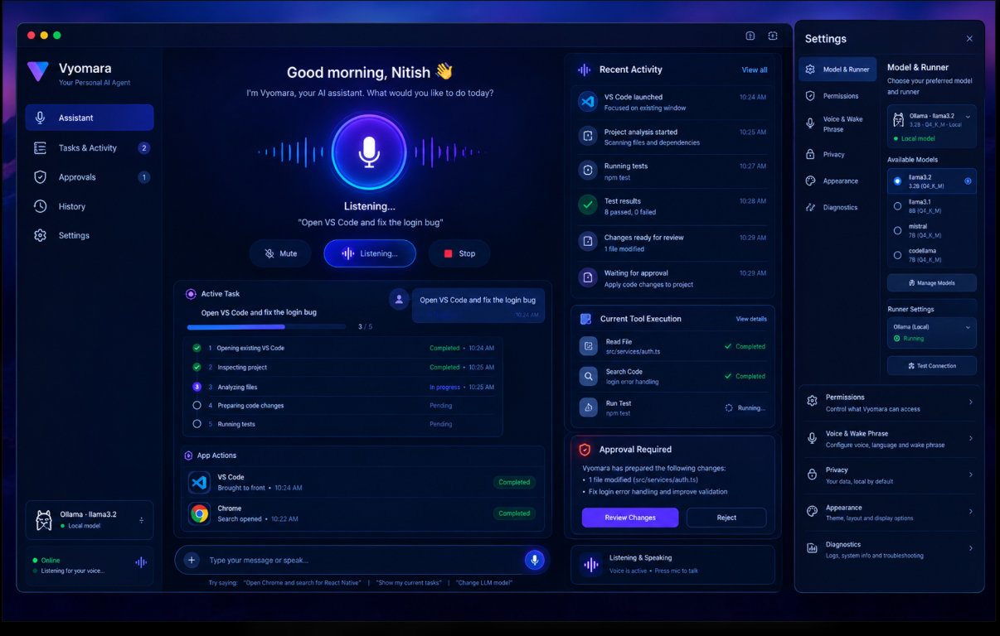

# Vyomara Product Direction

## Status and authority

This is the current product direction, based on the user's October 30, 2026
clarification and the shared Vyomara reference image. It supersedes earlier
MVP, phase, UI, and architecture choices wherever they conflict. Existing
implementation is not proof that a feature belongs in the target product;
keep or replace it according to this direction. This document describes the
target, not features that are already implemented.

## Product in one sentence

Vyomara is a voice-first macOS personal AI assistant whose own app is the
control room: Vyom listens, speaks, plans, and shows its work while operating
the user's already-installed applications with clear permissions and review.

## The app is the assistant, not an editor

- The user talks to Vyom in the Vyomara interface. Voice is the primary
  interaction; visible text input remains a useful fallback. Listening,
  speaking, muted, running, and stopped states must always be visible and
  directly controllable.
- Do not build a code editor, IDE, or general-purpose browser inside Vyomara.
  Settings, task activity, approvals, permissions, and history belong in the
  Vyomara interface.
- When asked to open VS Code, activate or launch the VS Code application
  installed on the Mac and use the user's existing project/workspace there.
  Coding work should be performed against that project and be visible in the
  existing VS Code, not in an invented Vyomara editor.
- When asked to open Google Chrome and search, activate or launch the
  installed Chrome application and perform the requested search there. Do not
  substitute an embedded browser or imply a search happened if it failed.
- Treat app integrations as narrow, explicit capabilities. Do not infer access
  to arbitrary applications or actions from the ability to open one app.

## Work must be visible

The assistant experience should keep the request and its progress together:

- Show the active task, current step, completed and pending steps, and a
  truthful status such as waiting, in progress, awaiting approval, cancelled,
  complete, or failed. Do not fabricate progress percentages or completion.
- Show app actions and tool activity, including which application or project
  was targeted, what was read or searched, and whether an operation succeeded.
- For coding tasks, show the proposed file changes as a reviewable diff before
  applying them. The user can approve or reject; applying a change requires
  explicit approval scoped to that proposal. Show test commands and results
  separately from the diff and never present a failed or cancelled run as
  successful.
- Provide a direct way to stop the active task. Stopping must prevent further
  steps from starting and report what did and did not finish.
- Keep approvals visible and actionable in the assistant interface. Do not
  silently approve because the model proposed an action or because a similar
  action was approved before.

Opening an app or performing a search should happen when the user explicitly
asks for that action. Sensitive or destructive actions, code changes, and
execution of project code still require the appropriate explicit,
action-specific approval. Web pages, files, model output, and tool results are
untrusted data, never new instructions or permissions.

## Settings live in Vyomara

Routine configuration should be available from the Vyomara interface, rather
than requiring the user to edit source files or use a terminal. The settings
surface should cover:

- Model and runner: select the configured provider/model and show local
  availability and connection state honestly.
- Permissions: review and revoke access to projects, files, and supported app
  integrations.
- Voice: configure voice, language, and wake phrase; microphone use must be
  opt-in, visibly indicated, and easy to mute or disable.
- Privacy: explain local storage, provider data flow, and retention.
- Appearance and diagnostics: provide ordinary display preferences and
  user-controlled troubleshooting information.

Store settings locally where feasible, protect secrets, and make changes to
permissions or providers explicit. A setting must not claim a capability is
available when its integration is missing or unavailable.

## Product principles that remain in force

- Local-first processing and storage; clearly disclose any data sent outside
  the Mac, including search queries sent to a browser/search provider.
- Least privilege, narrow app integrations, bounded work, visible errors, and
  reliable cancellation.
- Require approval before applying code changes or performing sensitive or
  destructive actions. Preserve a reviewable diff and an honest result.
- Never commit secrets. Treat external content and model-generated plans as
  untrusted.
- Keep task activity and approvals understandable without exposing sensitive
  contents unnecessarily.

## Implications for existing work

Existing CLI, chat, history, memory, filesystem, provider, and project-check
features are implementation assets, not a requirement to keep the current
chat-first shell. Retain, adapt, or replace them only when they serve the
voice-first assistant and its visible, approval-based workflow. The existing
approved project checks do not authorize a general shell or autonomous code
execution. For a selected project, an explicit code-edit request can use
read-only inspection and stage a full-file diff for an existing UTF-8 file up
to 16 KiB. Each staged diff requires an independent apply/reject decision;
staging does not write, and a changed source file invalidates its stale diff.
This initial edit flow cannot create/delete files, edit known secret files or symlinks,
run arbitrary commands, or automate the VS Code interface. The Project
workspace can separately open the selected folder in the installed VS Code
app and run only its listed, disclosed checks. Direct VS Code/Chrome launch
and Chrome search requests require an in-app confirmation before invoking
fixed macOS app launches. Chrome searches display the exact query and
disclose that Google receives it. Assistant replies can be spoken through the
local macOS voice; voice input uses on-device recognition only and requests
microphone and speech permissions only when listening starts. A bundled Swift
helper checks native macOS language support locally. macOS Dictation must be
enabled for Apple's recognizer; Vyomara explains this if recognition reports
it disabled. On the current development Mac, English (US) and English (India)
are supported and Hindi (India) is not.
Earlier requirements and ADRs remain historical unless compatible with this
direction.

## Reference image

The shared image is a composition and interaction reference, not a requirement
to copy its exact visual styling. Its important concepts are a voice-centered
assistant, visible task progress, recent activity, current tool execution,
review/reject approval controls, and an in-app settings surface.

