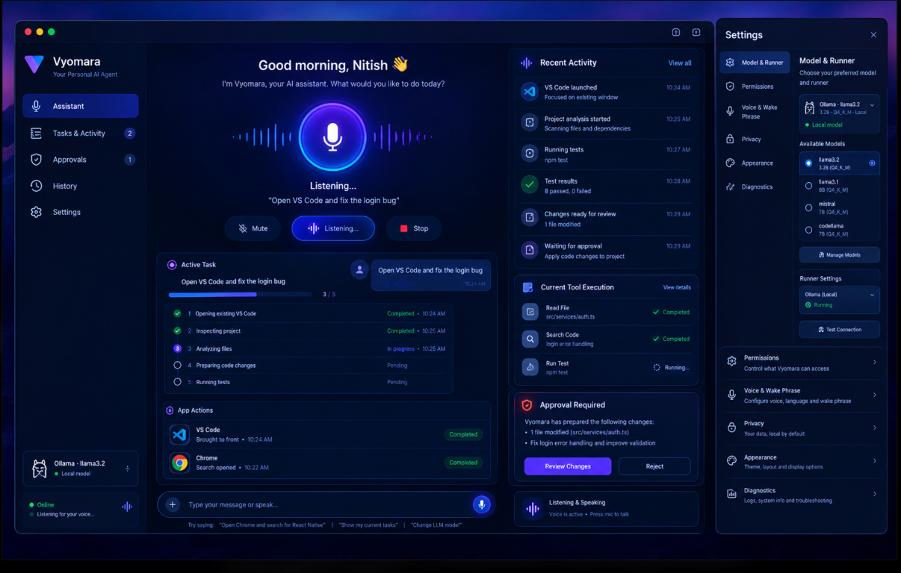

# Vyomara Product Direction

> This document is authoritative. Where it conflicts with the historical
> [requirements](./requirements.md) or older ADRs, this document and
> [ADR-0015](./adr/0015-coding-agent-loop-and-approved-actions.md) win.

## Vision

Vyom is a personal AI agent that operates the user's Mac on their behalf. The
user states an outcome and the agent does the work:

- **Code like a capable coding agent:**
  - Find the project and the relevant files without being told where they
    are.
  - Read and understand the code.
  - Make focused edits, run tests and builds, and fix what fails.
- **Operate apps:** open VS Code on a project, open Chrome and search or browse,
  and other applications and tasks over time.
- **By voice:** typing first, then a voice-first experience with the same
  capabilities.

## Phases

1. **Coding agent, typed (current focus).** Make Vyom reliable at coding work
   in the desktop chat and CLI:
   - Discovery: project folders, name/glob search, content search, and
     ranged reads.
   - Reviewed edits.
   - Approved shell commands for tests, builds, and git.
   - Honest verified-action reporting.
   - Model choice in the UI.
2. **Apps and the web.** Today, each after approval:
   - Open any app, optionally with a file or folder.
   - Open web pages or Google searches in a chosen browser.
   - Read web pages itself, telling the user which site receives the request.
   - Search the web through a configured SearXNG instance.

   Next:
   - Richer app integrations (VS Code workspace/terminal, Finder, Notes,
     Calendar).
   - Reusable task recipes.
3. **Voice-first.** Make the existing offline voice input and spoken replies
   the primary way to work:
   - Wake phrase ("Hello Vyomara").
   - Spoken approvals with a visible confirmation.
   - Concise spoken summaries of long results.

## Desktop app

Keep the interface focused:

- **Assistant chat:**
  - Markdown replies.
  - A live list of every step the agent takes.
  - A Stop button.
- **Approvals:**
  - A diff for each file change.
  - The exact command and folder for each shell command.
  - The app and target, or the URL and receiving website, for each launch.
  - `DELETE` confirmation for each deletion.
- **Permissions:** allow apps, browsers, and websites once so Vyom stops
  asking. Every grant can be revoked.
- **History:** review, export, and delete conversations.
- **Models:** list installed Ollama models, switch models, and download new
  ones.
- **Voice:** offline input and local spoken replies.

No manual project selection. Memory management and other settings panels are
deferred until there is a clear need.

## Product principles

- **Outcome first.** The agent explores, acts, and verifies until the task is
  done, within visible step limits. It does not stop to ask permission for
  read-only steps.
- **The user approves every change to the world.** This covers edits,
  deletions, commands, app launches, and web pages. Each approval covers
  exactly one action, and rejection is respected. For low-risk actions the
  user repeats (opening VS Code or Chrome, reading a docs site), a standing
  permission granted once replaces the prompt. File changes are always
  reviewed.
- **Truthful status.** Show real progress and errors. Only claim what a tool
  result confirms; the verified-actions list is the source of truth.
- **Local-first.** Models run in local Ollama. Clearly disclose anything that
  leaves the Mac, for example a URL opened in a browser.
- **Untrusted content.** File contents, web pages, tool results, and model
  plans are data, never instructions.
- **Least privilege and bounded work:**
  - Protected system and credential paths are blocked.
  - Steps and output are bounded.
  - Cancellation is reliable.
- **Speak the user's language.** Support English, Hindi, and Hinglish (in
  Roman script when the user writes that way).

## Reference image

The shared interface image is a composition and interaction reference, not a
requirement to copy its exact visual styling.

